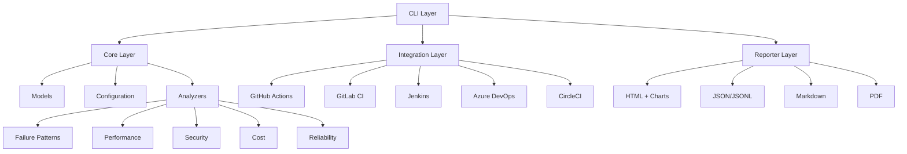

<div align="center">

# 🏥 Pipeline Doctor


**CI/CD Pipeline Diagnostics & Health Monitoring Tool**

*Diagnose, monitor, and optimize your CI/CD pipelines across GitHub Actions, GitLab CI, Jenkins, Azure DevOps, and CircleCI.*

[](https://pypi.org/project/pipeline-doctor/)
[](https://github.com/Jani-shiv/pipeline-doctor/pkgs/container/pipeline-doctor)

</div>

---

## 🌟 Features

| Feature | Description |
|---------|-------------|
| 🔍 **Multi-Platform Support** | GitHub Actions, GitLab CI, Jenkins, Azure DevOps, CircleCI |
| 📊 **Real-time Diagnostics** | Analyze pipeline runs for failures, bottlenecks, and anomalies |
| 🎯 **Root Cause Analysis** | Automated failure classification with suggested fixes |
| 📈 **Performance Tracking** | Monitor duration trends, queue times, and resource usage |
| 🔒 **Security Scanning** | Detect secrets, vulnerable dependencies, misconfigurations |
| 💰 **Cost Optimization** | Identify wasteful runs, parallelization opportunities |
| 🔔 **Smart Alerting** | Slack, Email, PagerDuty, Webhooks notifications |
| 📋 **Rich Reports** | HTML, JSON, Markdown, PDF with interactive charts |
| 🔌 **Extensible** | Plugin architecture for custom analyzers & integrations |

---

## 🚀 Quick Start

### Installation

```bash
# Via pip (recommended)
pip install pipeline-doctor

# Via Docker
docker pull ghcr.io/jani-shiv/pipeline-doctor:latest

# From source
git clone https://github.com/Jani-shiv/pipeline-doctor.git
cd pipeline-doctor
pip install -e ".[dev]"
```

### Configuration

```bash
# Copy example config
cp config/example.yaml config/pipeline-doctor.yaml

# Add your tokens as environment variables
export GITHUB_TOKEN=ghp_xxxxxxxxxxxx
export GITLAB_TOKEN=glpat_xxxxxxxxxxxx
# ... etc
```

### Basic Usage

```bash
# Analyze a specific GitHub Actions run
pipeline-doctor analyze \
  --platform github \
  --repo owner/repo \
  --pipeline 12345678 \
  --run 87654321

# Generate health report for last 30 days
pipeline-doctor report \
  --platform github \
  --repo owner/repo \
  --pipeline 12345678 \
  --days 30 \
  --format html \
  --output health-report.html

# Monitor pipelines in real-time
pipeline-doctor monitor \
  --platform github \
  --repo owner/repo \
  --pipeline 12345678 \
  --webhook-url https://your-webhook

# Scan local pipeline config for issues
pipeline-doctor scan .github/workflows/ci.yml --platform github
```

---

## 📸 Screenshots

<div align="center">

### HTML Report with Charts


### Terminal Output
```bash
$ pipeline-doctor analyze --platform github --repo owner/repo --pipeline 12345678

🏥 Pipeline Doctor Analysis Summary
Pipeline: abc123...
Platform: github
Total Findings: 5

┌─────────────┬───────┐
│ Severity    │ Count │
├─────────────┼───────┤
│ 🔴 Critical │ 1     │
│ 🟠 Error    │ 2     │
│ 🟡 Warning  │ 1     │
│ 🔵 Info     │ 1     │
└─────────────┴───────┘

🔴 CRITICAL: Failure pattern detected: out_of_memory
   Job: build | Step: compile
   💡 Increase memory limits or optimize memory usage
```

</div>

---

## 🏗️ Architecture



---

## 🧰 Built-in Analyzers

| Analyzer | Category | Description |
|----------|----------|-------------|
| `failure` | 🔴 Critical | Timeout, OOM, permission denied, connection issues, disk full |
| `performance` | 🟡 Warning | Slow pipelines, jobs, steps; queue time; resource waste |
| `security` | 🔴 Critical | API keys, tokens, passwords, private keys, misconfigurations |
| `cost` | 🔵 Info | Compute cost, waste detection, parallelization opportunities |
| `reliability` | 🟡 Warning | Flaky tests, retries, timeouts, historical failure rates |

---

## 📊 Reporters

| Format | Use Case | Features |
|--------|----------|----------|
| **HTML** | Dashboards, sharing | Interactive charts, collapsible findings, themes |
| **JSON** | Automation, APIs | Machine-readable, full metadata |
| **JSONL** | Log aggregation | Streaming, Elasticsearch/Splunk ready |
| **Markdown** | Documentation | GitHub-flavored, collapsible sections |
| **PDF** | Compliance, archival | Professional, print-ready |

---

## 🔧 Configuration

```yaml
# config/pipeline-doctor.yaml
platforms:
  github:
    enabled: true
    token: "${GITHUB_TOKEN}"
    owner: "your-org"
    repo: "your-repo"

analyzers:
  failure:
    enabled: true
    config:
      custom_patterns:
        - pattern: "my_custom_error"
          severity: "warning"
          suggestion: "Check custom error"

reporters:
  html:
    enabled: true
    config:
      theme: "dark"
      include_charts: true

notifications:
  slack:
    enabled: true
    webhook_url: "${SLACK_WEBHOOK}"
    channel: "#pipeline-alerts"
```

---

## 🤝 Contributing

We welcome contributions! See [CONTRIBUTING.md](CONTRIBUTING.md) for guidelines.

```bash
# Development setup
git clone https://github.com/Jani-shiv/pipeline-doctor.git
cd pipeline-doctor
python -m venv venv && source venv/bin/activate
pip install -e ".[dev]"
pre-commit install

# Run tests
pytest
ruff check src tests
mypy src
```

---

## 📈 Star History

<div align="center">
  
[](https://star-history.com/#Jani-shiv/pipeline-doctor&Date)

</div>

---

## 📜 License

MIT License - see [LICENSE](LICENSE) for details.

---

## 👤 Author

<div align="center">

### **Shiv Jani**
*DevOps Engineer & Cloud Enthusiast*

Passionate about automation, scalable systems, and modern deployment workflows.

</div>

<div align="center">

[](https://github.com/Jani-shiv)
[](https://linkedin.com/in/shiv-jani)
[](https://jani-shiv.github.io/Shiv_Jani/)
[](mailto:shiv.jani@example.com)

</div>

<div align="center">

### 🏢 Currently at **Elastic**
### 📍 Based in **Ahmedabad, Gujarat**

</div>

---

## 🙏 Acknowledgments

- Built with [Typer](https://typer.tiangolo.com/) for CLI
- Uses [Rich](https://rich.readthedocs.io/) for beautiful terminal output
- Powered by [Pydantic](https://pydantic.dev/) for data validation
- Charts by [Chart.js](https://www.chartjs.org/)

---

<div align="center">

**Made with ❤️ by [Shiv Jani](https://github.com/Jani-shiv)**

*If you find this project useful, please consider giving it a ⭐!*

</div>